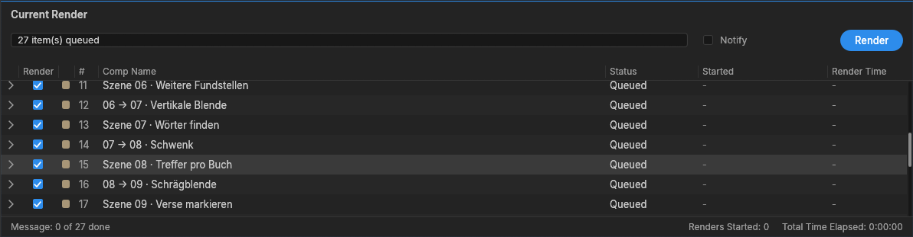

# Folge 01 · Akribos kennenlernen

[Video ansehen](folge-01.mp4) · [Animation in EffectCraft](folge-01.ecproj) · [Schnitt in FilmCraft](folge-01.fcproj)

Der 60-Sekunden-Film hat 14 Szenen und 13 Übergänge. Im FilmCraft-Projekt liegen die fertigen Bildclips auf V1, Sprecher, Musik und Soundeffekte auf drei eigenen Tonspuren. Für einen neuen Export kannst du das Projekt direkt öffnen.

## Als MP4 exportieren

1. Öffne [folge-01.fcproj](folge-01.fcproj) in FilmCraft, aktiviere die Sequenz **Folge 01 · Akribos kennenlernen** und wähle **File → Export → Media…**.
2. Wähle das H.264-Preset **Match Source – Adaptive High Bitrate**. Klicke unter **Video → Target Bitrate** auf **Set** und verwende **VBR, 1 pass**, Ziel **20 Mbit/s**, Maximum **30 Mbit/s**. Lass **GPU Rendering** ausgeschaltet. Bild und Ton der Folge sind **1920 × 1080, 30 fps, Rec. 709** und **AAC Stereo, 48 kHz, 320 kbit/s**.
3. Wähle **Range → Entire Source**, gib den Zielpfad an und klicke auf **Export**. Der freigegebene Stand im Repo heißt `folge-01.mp4`.

Du findest diese Werte auch direkt im Projekt. Markiere die Sequenz im Projektfenster und öffne **Window → Metadata → Clip**. Unter **Description** und **Comment** stehen die Einstellungen zum Nachschlagen. FilmCraft 0.20.1 speichert die persönliche Auswahl im Exportdialog außerhalb der Projektdatei.

## Eine Animation bearbeiten

1. Öffne [folge-01.ecproj](folge-01.ecproj) in EffectCraft. Unter **Szenen** findest du beispielsweise **02 · Bibelstelle öffnen** mit der Lupe oder **08 · Treffer pro Buch** mit Cursor, Klickring und Screenshot-Wechsel.
2. Speichere die Änderung. Wähle in der **Render Queue** die Szene und ihre angrenzenden Übergänge. Für Szene 08 heißen die drei Zeilen **07 → 08 · Schwenk**, **Szene 08 · Treffer pro Buch** und **08 → 09 · Schrägblende**. Die Namen stehen in der Spalte **Comp Name**, auch bei eingeklappten Zeilen. Lass für die Teilausgabe nur diese drei Häkchen aktiv und klicke auf **Render**. Die Ausgabeziele in [media/](media/) sind vorbereitet. Lass einen globalen **Default Output Folder** in EffectCraft leer, damit diese Pfade gelten.
3. Öffne das FilmCraft-Projekt erneut oder aktiviere unter **Settings → Media** die Option **Automatically refresh growing files**. Die ersetzten Clips erscheinen am bisherigen Platz im Schnitt. Exportiere den Film wie oben beschrieben.

Für einen anderen Anzeigenamen öffne im Projektfenster **Render-Ausgaben**, markiere die gewünschte Ausgabekomposition und drücke **Enter** oder wähle **Rechtsklick → Rename**. Die Render Queue zeigt ihren neuen Namen direkt an. Bildinhalt und Animation bearbeitest du weiterhin unter **Szenen** oder in der Hauptkomposition.

EffectCraft 0.24.1 kann beim Speichern absolute Medienpfade eintragen. Damit die Projekte nach einem Umzug oder Klonen weiter funktionieren, speichere deine Editoränderungen und führe vor dem Commit im **Repo-Hauptordner** `python3 scripts/project_paths.py folge-01-erklaervideo` aus.

Bei einer Linux-Flatpak-Installation braucht EffectCraft Lese- und Schreibzugriff auf den Checkout. Liegt er außerhalb der freigegebenen Ordner, führe im **Repo-Hauptordner** einmal `flatpak override --user --filesystem="$PWD" ai.storyteller.effectcraft` aus und starte EffectCraft neu.

## Material aktualisieren

- [Screenshots aufnehmen](capture/README.md) – Namen, Bibelstellen, Fenstergrößen und Ausschnitte stehen in [shots.json](capture/shots.json).
- [Sprechertext und Aufnahmen](voiceover/README.md) – Sprechfassung für sieben Absätze, Runway-Aufnahmen, Schnittpunkte und fertige Sprachspur.
- [Gemeinsame Schriften installieren](../README.md#schriftarten-installieren) – **Akribos Text** in Regular und SemiBold.
