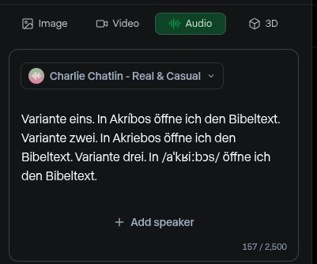

# Aussprache von Akribos

In [der Runway-Hörprobe](akribos-aussprache-runway.mp3) spricht Charlie Chatlin den Satz „In Akribos öffne ich den Bibeltext“ dreimal. Variante 1 und Variante 3 wurden für die Reihe ausgewählt. Die Betonung liegt auf dem **i** in der zweiten Silbe.

Für neue Takes dient Variante 3 als Referenz. Gib in Runway beim Modell **Eleven v4** im Satz `/aˈkʁiːbɔs/` ein. Höre die Aufnahme im vollständigen Satz ab, denn dieselbe Eingabe kann im Satz eine andere Betonung ergeben. Im Bild und in Untertiteln steht **Akribos**.

Das Referenzwort aus Variante 3 liegt bei **10,195 bis 10,880 Sekunden** der MP3. In den Folgen 01 (erster Satz mit dem Namen), 02 und 04 wurde dieses gesprochene Wort direkt in die Sprecheraufnahme eingesetzt. Die Schnittpositionen stehen pro Folge unter `voiceover/aussprache-schnitt.json`. Die WAV-Spur im FilmCraft-Projekt enthält den fertigen Schnitt.

